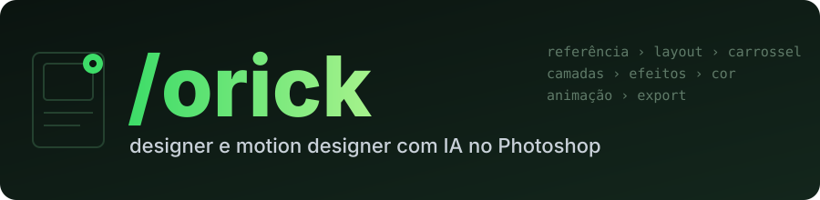

<div align="center">

[](#readme)

[](https://github.com/gabrielxreis/orick/commits/main "Histórico")
[](https://claude.com/claude-code "Claude Code")
[](#requisitos "Requisitos")
[](#canva "Canva")
[](#onde-o-rick-trabalha "Onde o Rick trabalha")
[](#requisitos "Requisitos")
[](#requisitos "Requisitos")
[](#requisitos "Requisitos")
[](LICENSE "Licença")

</div>

**/orick** (o Rick) é uma skill do Claude Code que é **designer e motion designer**. Faz design a partir das suas referências (post, carrossel, story, capa de Reels e miniatura do YouTube, anúncio, banner, mockup, recorte e tratamento de foto) e depois **anima** a peça (PSD em movimento, carrossel em vídeo, logo e título animados). **Você escolhe onde ele trabalha:** no **Adobe Photoshop** (tudo em camadas editáveis: texto com a fonte de verdade, formas vetoriais, smart objects, estilos e camadas de ajuste), no **Canva** ou **só com IA** de imagem (ChatGPT, Gemini). Sem Photoshop ele funciona do mesmo jeito: na instalação ele vê o que você tem e sugere. Toda peça é conferida olhando a imagem exportada. É o irmão de design do [**/ogab**](https://github.com/gabrielxreis/ogab), o editor de vídeo, e usa o motor de motion dele.

> Antes se chamava **/oyoshi** (o Yoshi). Quem já tinha instalado: veja [Veio do /oyoshi?](#veio-do-oyoshi).

* [INSTALAÇÃO](#instalacao)
    * [Onde o Rick trabalha](#onde-o-rick-trabalha)
    * [Requisitos](#requisitos)
* [COMO O RICK TRABALHA](#como-o-rick-trabalha)
* [CARROSSEL](#carrossel)
* [MOTION](#motion)
* [COMO O RICK CONTROLA O PHOTOSHOP](#como-o-rick-controla-o-photoshop)
* [O QUE JÁ FUNCIONA](#o-que-ja-funciona)
* [PRESETS DE ESTILO](#presets-de-estilo)
* [CRÉDITOS GENERATIVOS](#creditos-generativos)
* [GRAVADOR DE AÇÕES](#gravador-de-acoes)
* [CANVA](#canva)
* [ARMADILHAS CONHECIDAS](#armadilhas-conhecidas)
* [ESTRUTURA DO REPOSITÓRIO](#estrutura-do-repositorio)
* [LICENÇA](#licenca)


# INSTALAÇÃO

```bash
git clone https://github.com/gabrielxreis/orick.git ~/.claude/skills/orick
```

Não precisa ter Photoshop. No primeiro `/orick`, o Rick olha o que tem na sua máquina (Photoshop, Canva, ChatGPT, IAs conectadas no Claude), sugere o melhor caminho e **você escolhe**: Photoshop, Canva ou só IA. Dá para ver ou refazer a detecção quando quiser:

```bash
python3 ~/.claude/skills/orick/scripts/detectar_apps.py detectar
```

Escolheu Photoshop? Com ele aberto, gere o catálogo da sua máquina (uma vez, e de novo quando o Photoshop atualizar):

```bash
python3 ~/.claude/skills/orick/scripts/sondar/catalogar.py
```

Depois é só pedir no Claude Code:

```
/orick faz um carrossel de 7 páginas ensinando suporte e resistência, no estilo dessas referências
/orick monta a capa do Reels com essa foto e anima pra 6 segundos
```

O Rick se atualiza sozinho (`git pull`) toda vez que é usado.

## Veio do /oyoshi?

O repositório mudou de nome (o GitHub redireciona o endereço antigo). Para trocar a pasta:

```bash
mv ~/.claude/skills/oyoshi ~/.claude/skills/orick
git -C ~/.claude/skills/orick remote set-url origin https://github.com/gabrielxreis/orick.git
```

O `.venv` continua funcionando; se o `pip` reclamar, recrie com `python3 -m venv ~/.claude/skills/orick/.venv`. Artes antigas (`arte.jsx`) não mudam: a biblioteca agora é `scripts/jsx/rick.jsx` e continua com as funções `Y.*`.

## Onde o Rick trabalha

| Motor | O que sai | Precisa de |
|---|---|---|
| **Photoshop** | PSD em camadas editáveis (texto vivo, smart objects, efeitos) + PNG | Adobe Photoshop no Mac ou no Windows (ideal o 2026) |
| **Canva** | design no Canva, editável por você ou pelo cliente | conector oficial do Canva no Claude (ou importar no app/canva.com) |
| **Só IA** | a peça pronta em imagem (PNG), página por página | ChatGPT ou Gemini no navegador, ou uma IA de imagem conectada |

O Rick sugere pelo que encontrou na máquina, mas a escolha é sua, e dá para pedir outro motor em qualquer peça.

## Requisitos

| O quê | Por quê |
|---|---|
| Python 3.10+ | Scripts do Rick. |
| Adobe Photoshop 2026 (27.x), **opcional** | Só no motor Photoshop. As ferramentas nativas do agente só existem no 2026; o básico (ExtendScript) funciona em versões antigas. Mac pela ponte AppleScript; Windows pela ponte COM (só o 2026 registra o COM). |
| Permissão de Acessibilidade para o Terminal | Só no motor Photoshop no Mac, para fechar alertas dele sozinho (System Events). |
| Windows: pacotes `winrt-*` no `.venv` | Só no motor Photoshop no Windows, para o OCR nativo do `reconstruir.py` (comandos no SKILL.md). "Localizar fonte semelhante" não abre por script no Windows: o comparador local de fontes cobre. |
| Canva, **opcional** | Só no motor Canva: conector oficial do Canva no Claude (autorizar em `/mcp`). |
| [/ogab](https://github.com/gabrielxreis/ogab) (opcional) | Só para a parte de motion (HyperFrames, carrossel em vídeo, After Effects). |

No Photoshop não precisa instalar plugin, abrir porta nem configurar senha.


# COMO O RICK TRABALHA

**Antes de montar, ele pergunta onde gerar** e você escolhe: Photoshop (PSD editável), ChatGPT, Gemini/Nano Banana, uma IA conectada (Higgsfield, Magnific, Artlist...) ou misto (cena na IA, texto no Photoshop). Geração que gasta crédito mostra o custo e o saldo antes.

**Ele se conecta com os irmãos:**

| O pedido envolve | Quem faz |
|---|---|
| vídeo (Reels, edição, timeline, anúncio em vídeo) | [/ogab](https://github.com/gabrielxreis/ogab), o editor; o Rick entrega capa, lettering e PSD para animar |
| design (post, carrossel, capa, thumbnail, banner, criativo estático) | /orick |
| tráfego (resultado de campanha, criativos que performam, concorrentes, público) | /ojhon, o gestor de tráfego; no criativo de anúncio ele faz o brief antes e audita as peças depois |


# CARROSSEL

O Rick tem um método próprio de carrossel ([`docs/carrossel.md`](docs/carrossel.md)), aprendido de um carrossel educativo de 7 páginas que o cliente aprovou de primeira:

1. **A marca manda:** paleta, fontes, logo, rodapé e o motor que o cliente prefere.
2. **Planeja e mostra antes:** uma linha por página. Sequência: capa com gancho e 3 temas > metáfora geral > um conceito por página, cada um com a sua **metáfora do dia a dia em foto** > fixação ("Guarde isso!") > conversão com o link.
3. **Monta** num destes motores:

| Motor | Quando | Sai |
|---|---|---|
| **Photoshop** | quer o arquivo editável, vai virar série | PSD com uma prancheta por página + PNG |
| **IA de imagem** (ChatGPT, Nano Banana) | o cliente gosta do resultado da IA, ou faltam fotos para as metáforas | PNG por página (briefing único + uma página por mensagem, conferindo acento e rosto) |
| **HTML / motion do /ogab** | tipográfico rápido sem foto, ou carrossel em vídeo | PNG/PDF ou MP4 |

4. **Escolhe o tipo antes:** educativo (lista, antes/depois, mito/realidade, método), campanha de produto em 3 páginas (produto completo > em uso > fechamento de marca) ou motion.
5. **Entrega** com um comando: versão do Instagram (1080x1350, corte central) e uma folha com todas as páginas numeradas.

```bash
python3 ~/.claude/skills/orick/scripts/carrossel_entrega.py <pasta_das_paginas>
```

Estilo pronto: [`presets/carrossel-educativo`](presets/carrossel-educativo/README.md) (foto cinematográfica com a metáfora, título condensado em duas cores, exemplo em caixa, blocos glitch nas bordas, rodapé fixo).


## Manual criativo

O básico que o Rick aplica em toda peça está em [`docs/manual_criativo.md`](docs/manual_criativo.md): ordem de prioridade entre pedido, correção e marca; ideia antes do efeito; cor natural na foto (a cor da marca só nos detalhes); fotografia realista, fisheye sem vinheta, plano aberto com área para título e charge recortável por IA; edição pontual que preserva o resto; margens de headline e zona segura do Reels; checagem de fatos; processo em 10 etapas, prompts prontos e checklist.


# MOTION

O Rick anima o que desenha usando o motor do [/ogab](https://github.com/gabrielxreis/ogab):

| O quê | Como |
|---|---|
| **Arte em movimento** | o PSD do Rick (grupos nomeados pela função) vira camadas animadas em HyperFrames com `arte_animada.py` (`ler` > `plano` > `montar` > render MP4) |
| **Carrossel em vídeo** | cada página se monta sozinha em ~6,5 s e para no quadro final (`carrossel_motion`) |
| **Títulos, listas, gráficos, logo reveal** | presets e biblioteca de motions do /ogab, renderizados com HyperFrames |
| **After Effects** | camadas editáveis no AE pela ponte do /ogab |

Vídeo editado (cortes, música, timeline no DaVinci) continua com o /ogab; o Rick entrega a peça animada.


# ERROS E PRESETS DA COMUNIDADE

O Rick usa o mesmo canal de relatos do [/ogab](https://github.com/gabrielxreis/ogab): quando ele corrige um erro da skill na sua máquina, aprende uma técnica nova, cria um script ou quando você cria um preset novo em `presets/<nome>/`, isso vai **anônimo** para a fila do Gabriel, que revisa e publica a melhoria para todo mundo no próximo update. O que é da sua marca (cores, fontes, textos) fica na pasta da marca e não sai.

- Só sai com o /ogab instalado e o consentimento de relatos que você deu nos termos dele (mudar: `/ogab config relatos sim|nao`).
- Saem a mensagem do erro, a causa, a correção e o diff do arquivo da skill. Caminhos, e-mails, chaves, seu nome e os nomes dos clientes são apagados antes de gravar.
- Preset vai como texto (README e preset.json); imagem e PSD vão só pelo nome. Nada de arte, foto ou texto de cliente.
- `python3 ~/.claude/skills/orick/scripts/relatar_rick.py status` mostra se esta máquina envia e o que está pendente.


# COMO O RICK CONTROLA O PHOTOSHOP

Engenharia reversa completa em [`docs/photoshop_api.md`](docs/photoshop_api.md). Resumo:

| Camada | O que é |
|---|---|
| **Agente nativo do Photoshop** | O Photoshop 2026 traz um "MCP interno" (o motor do Assistente de IA): **137 ferramentas com JSON Schema** + 18 escondidas, chamadas pelo Action Manager (`listTools` / `executeTool`). Validam parâmetros e respondem em JSON. |
| **ExtendScript + Action Manager** | DOM clássico (33 classes reflexionadas, índice completo de 93 classes e 725 enums) e qualquer evento que o Photoshop grava: smart objects, estilos de camada, formas, IA local. |
| **Comandos dos painéis da Adobe** | 257 comandos batchPlay extraídos do JavaScript dos 23 painéis internos do próprio Photoshop (Neural Filters, troca de céu, exportar sem diálogo...). |
| **Menu pela tela** | 759 comandos de menu catalogados com o ID, para o raro caso sem script. |

```python
import sys, os; sys.path.insert(0, os.path.expanduser("~/.claude/skills/orick/scripts")); import ps_lib as PS
d = PS.doc_frente()
PS.ferramenta("document_create_text_layer", {"doc_id": d, "text": "TÍTULO", "font_postscript_name": "Montserrat-Bold",
    "font_size": {"value": 96, "unit": "pixels"}, "position_x": 50, "position_y": 20, "position": "top"})
PS.js("app.activeDocument.layers.length")
```


# O QUE JÁ FUNCIONA

**Arte completa em camadas em 10-20 segundos.** O Rick escreve a peça como um roteiro (`arte.jsx`) usando a biblioteca `rick.jsx` (grupos, cor, degradê, foto ajustada à caixa, recorte de pessoa com IA local, texto com trechos coloridos, formas, efeitos, grão) e o `montar.py` constrói o PSD e o PNG. Exemplo: [`presets/igreja-moderna/exemplo`](presets/igreja-moderna/exemplo).


Testado no Photoshop 2026 (27.11), Mac:

- Documento novo, pranchetas (carrossel num PSD só), grupos, máscaras de corte.
- **Texto** com fonte por PostScript name, cor, alinhamento, caixa de parágrafo e texto que se ajusta sozinho ao bloco.
- **Smart object:** colocar imagem e **trocar o conteúdo** (base de template e mockup).
- Formas vetoriais com canto arredondado, cor sólida, degradê, **estilos de camada** (sombra, traço).
- **14 tipos de camada de ajuste** com parâmetros e 36 presets de cor prontos.
- **Selecionar assunto e remover fundo** (IA local, sem crédito).
- Ler a estrutura inteira do documento (camadas, tipo, posição, máscara, bloqueio) em milissegundos.
- 7 conjuntos de Ações da Adobe já instalados: redimensionar para Instagram/Facebook/X/miniatura do YouTube, desfocar fundo, grades de composição, exportar.
- Exportar PNG, JPG e PSD em camadas, e conferir olhando a imagem.


# DA REFERÊNCIA AO PSD IDÊNTICO

O Rick foi treinado remontando posts reais pixel a pixel. As ferramentas que saíram disso:


*À esquerda, o JPG achatado. À direita, o PSD que o Rick reconstruiu sozinho: fundo limpo, 9 camadas de texto vivo com a fonte reconhecida (Unbounded, Space Mono, Ivy Presto) e posição conferida em até 1 px. Único ajuste manual: `--corrigir "/ IGREJA=/IGREJA;•=·;IVNC=IVN©"` para três erros de leitura do OCR. Limite visível: a ponta dos dedos sobre o "G" ficou borrada pelo preenchimento do fundo.*

- **Imagem chapada -> PSD editável** (`reconstruir.py`): OCR nativo do macOS (ou do Windows) acha cada linha e palavra; o fundo vira "fundo limpo" (texto apagado com preenchimento sensível ao conteúdo, sem crédito); cada linha volta como texto vivo com a fonte reconhecida, negrito e cor de destaque detectados por palavra, caixa marca-texto como forma editável, interface do Instagram (seta, bolinhas) removida.
- **Ciclo idêntico** (`ciclo.py`): mede a referência, monta, mede o próprio resultado com a mesma régua e corrige até o erro ficar em 1 px.
- **Reconhecer a fonte** em quatro camadas: Localizar fonte semelhante da Adobe, comparador local (desenho + espessura + largura), prova de fogo no Photoshop (`provar_fontes.py`) e WhatTheFont.
- **Medir** texto (caixa, altura de maiúscula, altura-x, cor real), objeto (seleção por IA, ângulo e bordas de objeto reto), paleta 60/30/10 e grade de alinhamento da referência.
- **Template da marca** (`virar_template.py`): o post reconstruído vira molde; texto novo com `**negrito**` e `{{destaque}}`, série inteira com `lote.py`.
- **Produção**: versão story automática (`para_story.jsx`), carrossel em pranchetas, mockup em perspectiva exata, QA automático de contraste/zona segura/margens (`conferir_arte.py`).
- **Efeitos**: neon, cromado, extrusão 3D, sombra longa, texto vazado, retícula, dupla exposição, luz de recorte, sombra de contato, glitch RGB, LUT de cinema, mapa de deslocamento, texto em arco, Mesclar se, separação de frequência (detalhes em `docs/tecnicas.md`).


*Cada quadro é uma linha de `rick.jsx` sobre um texto vivo (continua editável no Photoshop). Gerado por script, sem IA e sem crédito.*

# PRESETS DE ESTILO

O Rick aprende um estilo dissecando PSDs profissionais (ou fazendo engenharia reversa de posts publicados) e guarda as **técnicas** como preset: árvore de camadas, tipografia (com alternativa gratuita), paletas, mesclagens e uma receita passo a passo. Nenhum arquivo de terceiros entra no repositório.

| Preset | O que é |
|---|---|
| [`igreja-culto`](presets/igreja-culto/README.md) | Flyer gospel: palco escuro, feixes de luz, cantor recortado e iluminado pela cor do palco, título com duas fontes na mesma palavra, anéis feitos com a letra "O", créditos em linha. Variação colagem. |
| [`igreja-moderna`](presets/igreja-moderna/README.md) | Editorial de rede de igrejas: "DMNGO" gigante, pregador saindo da moldura, colagem maximalista, fonte mono de serviço, rabiscos à mão, line-up em pirâmide, raios de cor. 5 arquétipos. |
| [`carrossel-educativo`](presets/carrossel-educativo/README.md) | Carrossel de 7 páginas que ensina com uma metáfora em foto por conceito: luz de cinema, título condensado em duas cores, exemplo em caixa, blocos glitch e rodapé fixo. Serve para qualquer nicho que ensina. |

Presets **por marca** (cores, fontes, árvore e regras de um cliente) ficam na pasta do cliente, fora do git.

# CRÉDITOS GENERATIVOS

Estas ferramentas usam o Firefly e **gastam créditos generativos da sua conta Adobe**. O Rick só usa com sua autorização na hora:

| Ferramenta | Modelo |
|---|---|
| Preenchimento generativo | Firefly Image 5 |
| Texto para imagem | Nano Banana 3 (via Firefly) |
| Expansão generativa | Firefly Image 4 |
| Upscale, nitidez e redução de ruído | Topaz (via Firefly) |
| Harmonizar | Firefly |


# GRAVADOR DE AÇÕES

O Rick aprende olhando: com o gravador ligado, cada ação que **você** faz no Photoshop (menu, painel, atalho) vira uma linha com o comando e todos os parâmetros. Você faz uma vez, ele repete por script.

```python
PS.gravar(True)    # você faz a ação no Photoshop
PS.gravar(False)   # o resultado fica em $TMPDIR/orick_gravacao.jsonl
```


# CANVA

O Canva não tem app local para controlar. O caminho é o **conector oficial do Canva** (MCP) no Claude, que gera, busca, exporta e edita designs (troca texto, imagem e título). No motor Canva o Rick planeja a peça, escreve os textos e prepara as imagens, e monta no Canva pelo conector; sem o conector, entrega as imagens e os textos separados para você importar. Está em **beta**: o fluxo mais completo (camadas, remake idêntico, templates da marca) continua sendo o do Photoshop.


# ARMADILHAS CONHECIDAS

- `app.runMenuItem` não funciona quando o script vem do AppleScript. Usar o comando do Action Manager equivalente.
- Menu pela tela só funciona com o Photoshop **na frente**; em segundo plano os itens aparecem desabilitados.
- Algumas ações abrem **alerta modal** que trava o Photoshop. A `ps_lib` fecha sozinha e guarda a mensagem em `PS.ALERTAS`.
- Nas ferramentas nativas, a posição do texto é em **% do documento** e o ID do documento é um UUID (não o número do DOM).
- A fonte vai pelo PostScript name (`Montserrat-Bold`), não pelo nome que aparece no menu.


# ESTRUTURA DO REPOSITÓRIO

```
SKILL.md                     instruções do Rick para o Claude
docs/photoshop_api.md        engenharia reversa: o que dá para fazer e como
docs/catalogo/               menus, DOM, vocabulário do Action Manager, testes
docs/catalogo/local/         gerado na sua máquina pelo catalogar.py (fora do git)
scripts/ps_lib.py            ponte Python com o Photoshop
scripts/jsx/                 bibliotecas ExtendScript (descritor para JSON, agente, gravador)
scripts/sondar/              scripts de sondagem para refazer a engenharia reversa
scripts/dissecar_psd.py      estuda um PSD sem abrir o Photoshop
scripts/jsx/rick.jsx        biblioteca de montagem (Y.texto, Y.colocar, Y.recortar...)
scripts/montar.py            roda um arte.jsx e gera PSD + PNG
scripts/carrossel_entrega.py páginas -> versão do Instagram + folha com todas
docs/carrossel.md            método de carrossel (tipos, planejar, motores, entregar)
docs/manual_criativo.md      regras gerais de criação, prompts de IA e checklist
scripts/extrair_so.py        tira fotos e logos de dentro dos smart objects de um PSD
presets/<estilo>/            técnicas de um estilo (README + preset.json)
```


# LICENÇA

MIT. O índice do DOM em `docs/catalogo/flue_api-index.txt` vem do projeto [sfkislev/flue](https://github.com/sfkislev/flue) (MIT). Photoshop e Firefly são marcas da Adobe; este projeto não tem ligação com a Adobe.
